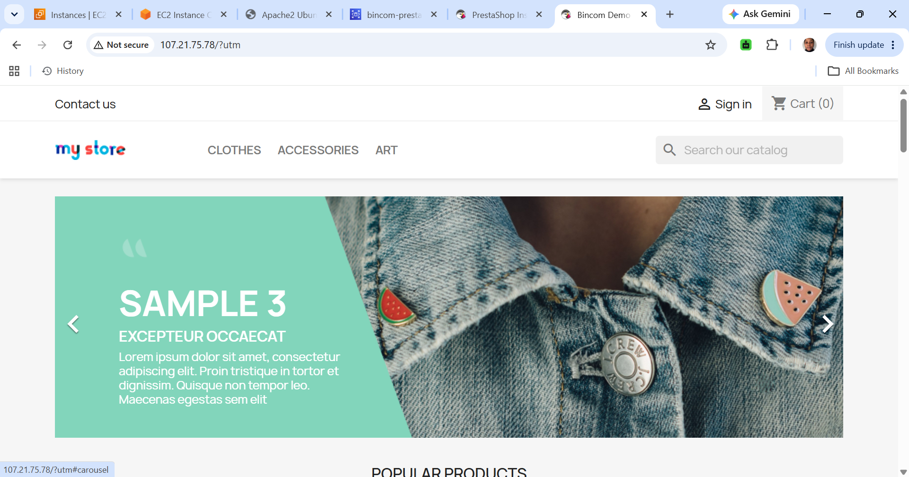
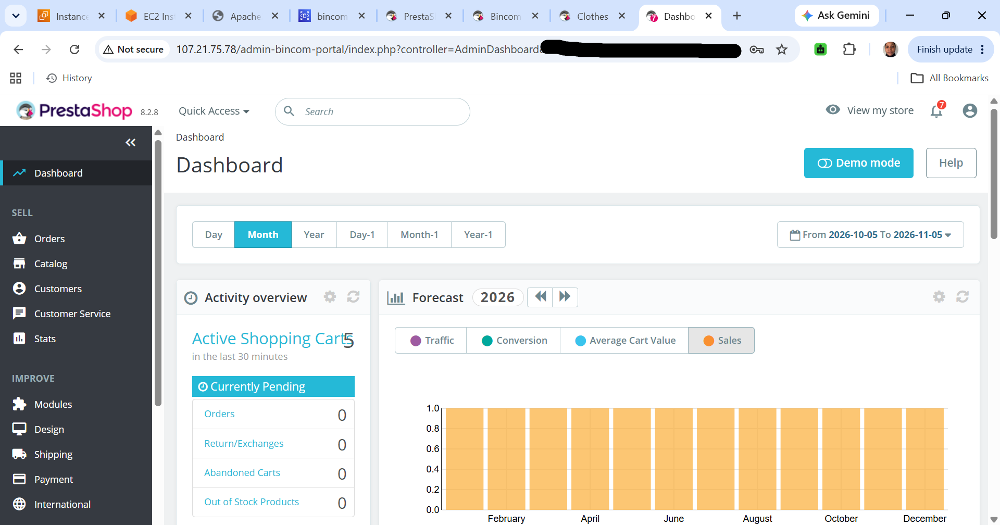
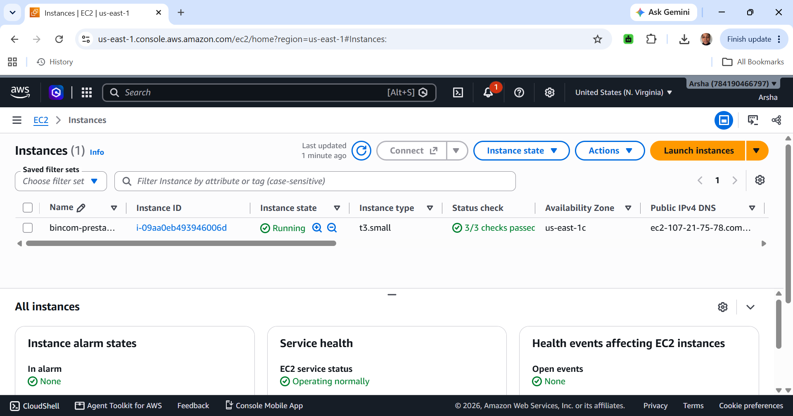
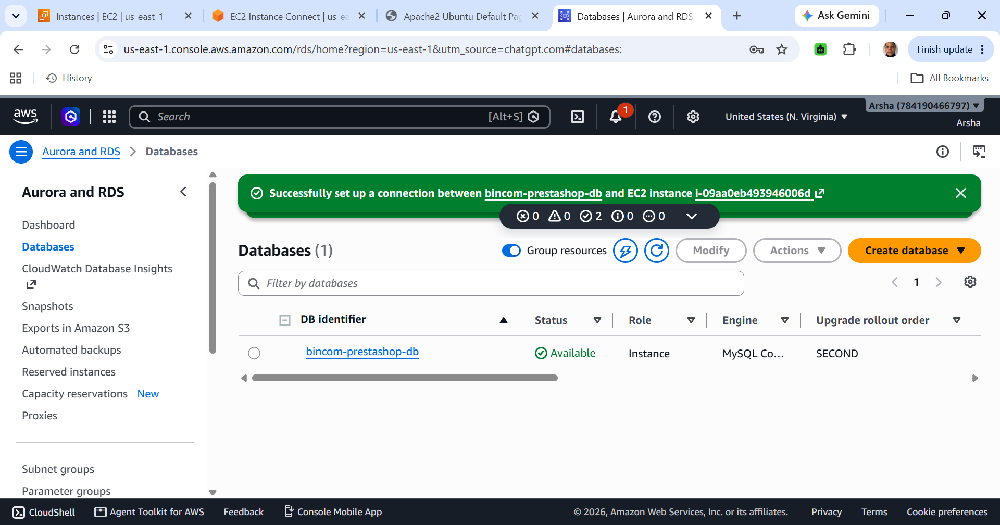
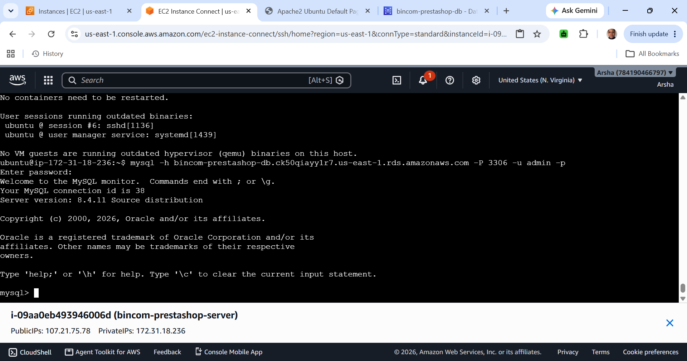

# PrestaShop Deployment on AWS

## Project Overview
This project documents my assessment deployment of PrestaShop, an open-source e-commerce application, on Amazon Web Services (AWS).

## Technologies Used
- AWS EC2
- Ubuntu Linux
- Apache Web Server
- PHP
- Amazon RDS MySQL
- PrestaShop

## Deployment Process
1. Provisioned an Ubuntu EC2 instance.
2. Configured the Apache web server and PHP environment.
3. Configured a MySQL database using Amazon RDS.
4. Installed and configured PrestaShop.
5. Tested access to the storefront and administration interface.

## Security Considerations
- Restricted access using AWS security groups.
- Configured database connectivity for the application.
- Protected the administrative interface.

## Challenges and Learning
This project strengthened my understanding of cloud infrastructure, Linux server administration, application deployment, database connectivity, and troubleshooting.

## Project Evidence
The screenshots below document the PrestaShop application deployment on AWS, including the public storefront, administration dashboard, EC2 instance, Amazon RDS database, and MySQL connectivity verification.

## Author
Cloud Engineering Portfolio Project
## Project Screenshots

### 1. PrestaShop Storefront

### 2. PrestaShop Admin Dashboard

### 3. AWS EC2 Instance

### 4. Amazon RDS Database

### 5. MySQL Database Connectivity

